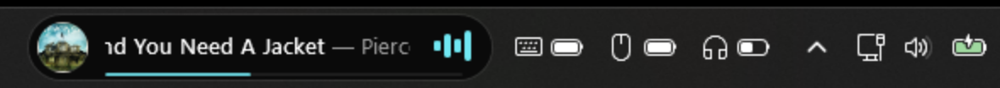

# Taskbar Island

Um widget discreto para a **barra de tarefas do Windows 11** que mostra, ao lado do relógio:

- 🎵 a **música que está tocando no Spotify** (capa, nome, artista, progresso e controles);
- 🔋 a **bateria dos seus periféricos sem fio 2.4 GHz** (teclado, mouse, fone), com o mesmo visual dos ícones do Windows.



Ele **acha seus aparelhos sozinho**: não tem nada para configurar. Só aparece o que você tem. Sem Spotify aberto, a parte da música some; aparelho que não foi encontrado não aparece.

> 🇺🇸 **English:** a small Windows 11 taskbar widget showing the Spotify track and the battery of 2.4 GHz wireless peripherals (AULA keyboards, Attack Shark mice, Logitech straight from the receiver or through G HUB, MCHOSE, Delux, VXE). Auto-detects devices, no setup. Download `TaskbarIsland-win-x64.zip` from [Releases](../../releases/latest), extract, run `TaskbarIsland.exe`. The UI follows the Windows language (Portuguese or English).

---

## Índice

1. [O que funciona com ele](#1-o-que-funciona-com-ele)
2. [Como instalar (passo a passo)](#2-como-instalar-passo-a-passo)
3. [Como usar](#3-como-usar)
4. [Modo jogo](#4-modo-jogo)
5. [Problemas comuns](#5-problemas-comuns)
6. [Atualizar](#6-atualizar)
7. [Desinstalar](#7-desinstalar)
8. [Segurança e privacidade](#8-segurança-e-privacidade)
9. [Para quem programa](#9-para-quem-programa)
10. [Créditos](#10-créditos)

---

## 1. O que funciona com ele

| O quê | Como ele lê | Status |
|---|---|---|
| **Spotify** (app do computador) | controles de mídia do Windows | ✅ testado |
| **Teclado AULA F75** pelo receptor 2.4 GHz | direto pelo receptor (chip "Compx") | ✅ testado |
| Outros **teclados AULA** com receptor 2.4 GHz (F87, F99, F65…) | mesmo receptor do F75 | ⚠️ deve funcionar, não testado |
| **Mouse Attack Shark X11** pelo receptor 2.4 GHz | direto pelo receptor | ✅ testado |
| **Fones Logitech novos** (G522 e parecidos) pelo receptor 2.4 GHz | direto pelo receptor, **sem precisar do G HUB** | ✅ testado com o G522 |
| **Mouses e teclados Logitech** (receptor Lightspeed, Unifying ou Bolt) | direto pelo receptor, **sem precisar do G HUB** | ⚠️ deve funcionar, ainda não testado aqui |
| **Qualquer aparelho Logitech com bateria** | pelo **G HUB**, quando ele estiver aberto | ✅ testado com o fone G522 |
| **Fone MCHOSE V9 Pro** pelo receptor 2.4 GHz | direto pelo receptor (só o pedido de bateria) | ⚠️ deve funcionar, ainda não testado aqui |
| **Mouse Delux M800 Pro** pelo receptor 2.4 GHz | direto pelo receptor (só leitura) | ⚠️ deve funcionar, ainda não testado aqui |
| **Mouse VXE Dragonfly R1** (R1, R1 Pro, R1 SE+) e Pulsar pelo receptor 2.4 GHz | direto pelo receptor (só leitura) | ⚠️ deve funcionar, ainda não testado aqui |

> ⚠️ = o protocolo veio de outros projetos que testaram com o aparelho de verdade (veja [Créditos](#10-créditos)), mas ainda ninguém confirmou com este widget. Se você tem um desses e funcionou (ou não), conta pra gente numa [issue](../../issues).

**Importante saber:**

- O aparelho precisa estar no **modo 2.4 GHz** (com o receptor USB / dongle plugado). No **cabo** ou no **Bluetooth** a porcentagem não aparece.
- Teclado AULA **carregando pelo cabo** mostra só o raio ⚡ (o próprio teclado não informa a porcentagem nesse modo).
- Aparelhos **Logitech** não precisam mais do **G HUB**. Se ele estiver aberto, o widget usa os dados dele; se não, lê direto do receptor.
- A música é **só do Spotify** — de propósito, para não ficar mostrando vídeo do YouTube etc.
- Precisa de **Windows 10 ou 11, 64 bits**. Feito pensando no Windows 11 (barra de tarefas embaixo).

---

## 2. Como instalar (passo a passo)

Não precisa instalar mais nada antes: tudo que ele precisa já vem dentro do arquivo.

### Passo 1 — Baixar

1. Abra a página de downloads: **[Releases → última versão](../../releases/latest)**.
2. Em **Assets**, clique em **`TaskbarIsland-win-x64.zip`** (uns 60 MB).

### Passo 2 — Tirar do zip

Abra a pasta **Downloads**, clique com o **botão direito** no arquivo `TaskbarIsland-win-x64.zip` → **Extrair tudo…** → **Extrair**. Vai abrir uma pasta com o arquivo **`TaskbarIsland.exe`** dentro.

> ❗ Não abra o programa **de dentro do .zip** (sem extrair).

### Passo 3 — Dois cliques

1. Dê **dois cliques** em **`TaskbarIsland.exe`**.
2. O Windows provavelmente vai mostrar uma tela azul **"O Windows protegeu o computador"**. Isso acontece com todo programa pequeno que não é de uma empresa grande (ele não tem "assinatura digital", que é paga). Para abrir:
   - clique em **Mais informações**;
   - depois em **Executar assim mesmo**.
3. Aparece o aviso **"Taskbar Island instalado! ✅"**. Pronto!

Ele **se instala sozinho** (numa pasta própria do Windows), aparece na barra de tarefas **à esquerda do relógio** e passa a **abrir sozinho toda vez que o Windows ligar**. Não abre janela nenhuma — é só isso mesmo. 🙂

Pode apagar o .zip e a pasta extraída depois.

---

## 3. Como usar

A parte da música funciona como uma "ilha" que muda de forma:

- **Tocando:** capa, nome da música, artista e um equalizador animado.
- **Pausado há mais de 30 segundos:** a ilha encolhe para só a capa e fica assim até você dar play (passar o mouse ainda abre o cartão).
- **Spotify fechado:** vira um botãozinho redondo com uma nota musical — clique nele para **abrir o Spotify**.
- A ilha e o cartão ganham um **tom da cor da capa** do álbum.


Clicando na **engrenagem ⚙** no canto de cima do cartão, aparecem as opções (elas ficam salvas):

- **🎮 Modo jogo** (chavinha): ligado = o widget some nos jogos em tela cheia; desligado = ele continua aparecendo mesmo jogando.
- **Bolinhas de cor:** a primeira (colorida) usa a **cor da capa** automaticamente; as outras deixam uma **cor fixa** (rosa, azul, verde, roxo, laranja ou branco).
- **🔊 Volume do Spotify** `BETA` (chavinha, vem desligada): coloca uma **barra de volume** no cartão. Veja [Volume do Spotify](#volume-do-spotify) logo abaixo.

### Volume do Spotify

> 🧪 **Recurso em teste (beta).** Funciona, mas é novo e pode ter falhas. Se algo der errado, é só desligar a chavinha: o Spotify volta ao original. Conta pra gente numa [issue](../../issues) como foi.

O Windows não informa o volume do Spotify para outros programas. Para o cartão ter uma barra de volume, o widget coloca um **pequeno ajuste dentro do app do Spotify** (um script minúsculo que só mexe na barrinha de volume do próprio Spotify e conversa só com o widget, dentro do seu computador).

1. Abra o cartão, clique na **engrenagem ⚙** e ligue **Volume do Spotify**.
2. Vai aparecer **"Reabra o Spotify para ativar o volume"**: clique em **Reabrir agora** (a música pausa por uns segundos).
3. Pronto: a barra de volume aparece embaixo dos botões. Dá para **clicar, arrastar** ou usar a **rodinha do mouse** em cima dela; o ícone 🔈 ao lado silencia / volta.

- Quando o Spotify se atualiza, ele apaga o ajuste. O widget percebe e coloca de novo sozinho; às vezes pede para reabrir o Spotify mais uma vez.
- **Desligar a chavinha tira o ajuste** e o Spotify volta a ser exatamente o original.
- ⚠️ **Spotify instalado pela Microsoft Store não funciona**: a Store tranca os arquivos do app. Nesse caso a opção aparece apagada, com um aviso e o link para **baixar o Spotify pelo site** ([spotify.com/download](https://www.spotify.com/download/windows/)) — é o mesmo Spotify, com a sua conta, e dá a melhor experiência com o widget.
- É um ajuste não oficial (o Spotify não oferece isso). Se um dia uma atualização grande do Spotify quebrar a barra de volume, ela só some do cartão até sair uma versão nova do widget; o resto continua funcionando.

| Ação | O que faz |
|---|---|
| Passar o mouse em cima da música | abre um **cartão acima da barra** com a capa grande, álbum, tempo da música e os botões **🔀 ⏮ ⏯ ⏭ 🔁** (aleatório e repetir ficam coloridos com um pontinho quando ligados; o repetir alterna entre desligado → playlist → só esta música) |
| Clicar ou arrastar a **barra de progresso** do cartão | pula para aquela parte da música |
| Clicar, arrastar ou rodinha na **barra de volume** do cartão | muda o volume do Spotify (só com a opção **Volume do Spotify** ligada) |
| Clicar na **capa** | tocar / pausar (no cartão: abre o Spotify) |
| **Rodinha do mouse** em cima da música | próxima / anterior |
| Passar o mouse em cima de uma **bateria** | mostra o nome do aparelho e a **porcentagem exata** |
| **Botão direito** em qualquer parte do widget | menu: **Iniciar com o Windows**, **Modo jogo** (liga/desliga), **Editar lista de jogos…**, **Abrir pasta do programa**, **Sair** |

**O que os ícones de bateria querem dizer:**

- a parte branca dentro da bateria = quanto de carga tem;
- 🔴 **vermelho** = 20% ou menos, hora de carregar;
- ⚡ **raio** = carregando;
- **apagado / transparente** = o aparelho está dormindo ou desligado (ele volta sozinho quando você usar o aparelho).

As cores da ilha, do equalizador e da barrinha de progresso mudam conforme a **cor da capa** do álbum.

---

## 4. Modo jogo

Quando você abre um **jogo em tela cheia** (ou vídeo em tela cheia), o widget **some sozinho e libera a memória**. Quando você sai do jogo, ele volta em uns 2 segundos.

Quer ver a música e as baterias **enquanto joga**? Desligue o **Modo jogo** (cartão → engrenagem ⚙ → chavinha, ou botão direito → Modo jogo).

Alguns jogos rodam em **"janela sem borda"** (borderless) e o Windows não avisa que é tela cheia. Para esses, coloque o jogo numa lista:

1. Abra o jogo.
2. Aperte **Ctrl + Shift + Esc** (abre o Gerenciador de Tarefas) → aba **Detalhes** → ache o jogo e anote o nome do **.exe** (ex.: `VALORANT-Win64-Shipping.exe`).
3. Botão direito no widget → **Editar lista de jogos…** → escreva o nome do .exe numa linha nova → salve (**Ctrl + S**).

Pronto, não precisa reiniciar o widget.

**Quanto ele gasta:** ~40–60 MB de memória normalmente (~20 MB no modo jogo) e cerca de 1% de CPU com a música tocando.

---

## 5. Problemas comuns

**Não aparece nada na barra.**
- Veja se ele está aberto: **Ctrl + Shift + Esc** → procure **TaskbarIsland**. Se não estiver, abra o `TaskbarIsland.exe` de novo.
- Ele só mostra alguma coisa se o **Spotify estiver aberto** ou se achar **algum aparelho compatível**. Sem nenhum dos dois, ele fica invisível de propósito.

**A música não aparece.**
- Tem que ser o **Spotify do computador** (o app), não o Spotify no navegador.
- Feche e abra o Spotify.

**Meu teclado / mouse não aparece.**
- Confira se está no **modo 2.4 GHz** (com o receptor USB plugado), e não no cabo ou Bluetooth.
- Mexa no aparelho (aperte uma tecla / mexa o mouse) para ele acordar e espere até 1 minuto.
- Se for outra marca/modelo que não está na [tabela](#1-o-que-funciona-com-ele), provavelmente ainda não é compatível.

**Meu aparelho Logitech não aparece.**
- Ligue o aparelho e espere até 1 minuto. Se ainda assim não aparecer, abra o **G HUB** (ícone perto do relógio): alguns modelos só informam a bateria por ele.

**Meu fone MCHOSE V9 Pro aparece, mas sem porcentagem.**
- Ligue o fone e espere até 1 minuto.
- Se continuar sem número, o receptor provavelmente está com o firmware de fábrica, que não informa bateria. Atualize o firmware **do receptor e do fone** pelo aplicativo/site oficial da MCHOSE (MCHOSE HUB) e abra o widget de novo.

**O widget ficou em cima dos ícones fixados da barra.**
- Acontece se você tem **muitos programas fixados** na barra e eles chegam até o canto direito. Desafixe alguns ou deixe os ícones da barra **à esquerda** (Configurações → Personalização → Barra de tarefas → Comportamentos → Alinhamento).

**O antivírus reclamou.**
- Programas novos e sem assinatura às vezes são marcados por engano. O código está todo aqui no repositório, aberto para quem quiser conferir.

---

## 6. Atualizar

Igual a instalar:

1. Baixe a versão nova em **[Releases](../../releases/latest)** e extraia (botão direito no .zip → **Extrair tudo**).
2. Dê **dois cliques** no `TaskbarIsland.exe` novo.
3. Aparece **"Taskbar Island atualizado para a versão X! ✅"**. Pronto!

Ele acha sozinho onde o widget está instalado, fecha a versão antiga, se coloca no lugar dela e abre de novo. Suas escolhas (cor, modo jogo, lista de jogos) não se perdem. Pode apagar o arquivo baixado depois.

> **Vindo da versão 1.1.2 ou mais antiga?** Essas ainda não tinham o atualizador. Nesse caso, faça uma vez do jeito manual: botão direito no widget → **Sair**; aperte **Ctrl + Shift + Esc** → aba **Detalhes**… (com o widget fechado, use a aba **Aplicativos de inicialização**) → botão direito em **TaskbarIsland** → **Abrir local do arquivo**; cole o `TaskbarIsland.exe` novo nessa pasta, escolhendo **Substituir**, e abra ele. Das próximas vezes, é só dar dois cliques.

---

## 7. Desinstalar

0. Se você ligou o **Volume do Spotify**, desligue a chavinha antes (engrenagem ⚙ do cartão): isso devolve o Spotify ao original.
1. Botão direito no widget → desmarque **Iniciar com o Windows** (isso apaga o atalho `Taskbar Island` da pasta Inicializar do Windows).
2. Botão direito → **Abrir pasta do programa** (deixe essa pasta aberta).
3. Botão direito no widget → **Sair**.
4. Apague o `TaskbarIsland.exe` da pasta que abriu (normalmente `%LOCALAPPDATA%\Programs\TaskbarIsland`).
5. (Opcional) Apague as configurações: aperte **Win + R**, cole `%APPDATA%\TaskbarIsland` e aperte Enter → apague essa pasta.

---

## 8. Segurança e privacidade

- **Não usa internet** e não coleta nada. Só conversa com coisas do próprio computador: os receptores USB, o G HUB e os controles de mídia do Windows.
- Com **Volume do Spotify** ligado, o widget acrescenta o arquivo `ti-volume.js` ao app do Spotify (`%APPDATA%\Spotify\Apps\xpui.spa`, com backup em `xpui.spa.taskbar-island.bak`). Esse script só lê e move a barra de volume do Spotify e só fala com o widget em `127.0.0.1` (o widget só aceita conexão vinda da página do próprio Spotify). Desligar a opção remove o script.
- O **mouse Attack Shark nunca recebe nenhum comando** — o widget só "escuta" o que o receptor já manda sozinho.
- O **teclado AULA recebe só um pedido de bateria** a cada 1 minuto (o mesmo que o programa oficial da AULA usa). Nenhuma configuração do teclado é alterada.
- O **fone MCHOSE** recebe só o pedido de bateria documentado, e os **mouses Delux e VXE** só consultas de leitura. Os comandos de configuração desses aparelhos (EQ, DPI, pareamento etc.) nunca são enviados.
- Não precisa rodar como administrador.

---

## 9. Para quem programa

C# / WPF (.NET 8), um único processo.

```
native/
  TaskbarIsland/
    Core/Protocols.cs   protocolos de bateria (parsers puros, testados)
    Core/Providers.cs   detecção automática: CompxProvider (AULA), XentaProvider (Attack Shark), GHubProvider (Logitech),
                        MchoseProvider (MCHOSE V9 Pro), DeluxProvider (Delux M800 Pro), VxeProvider (VXE / Pulsar)
    Core/Logitech.cs    LogitechProvider: Logitech direto do receptor (Centurion e HID++) enquanto o G HUB está fechado
    Core/Spotify.cs     música via controles de mídia do Windows (só Spotify)
    Core/SpotifyVolume.cs  volume opcional: injeta Spotify/ti-volume.js no xpui.spa e conversa por WebSocket local
    Core/Win32.cs       barra de tarefas, tela cheia, iniciar com o Windows
    Core/Installer.cs   o próprio .exe se instala / atualiza a cópia instalada (nunca rebaixa versão)
    Core/Strings.cs     textos PT/EN
    MainWindow.xaml(.cs) ilha (modos fechado/compacto/normal), baterias, modo jogo
    CardWindow.xaml(.cs) cartão expandido acima da barra
  TaskbarIsland.Tests/  testes dos protocolos (xUnit)
```

Compilar (precisa do [.NET 8 SDK](https://dotnet.microsoft.com/download/dotnet/8.0)):

```bash
cd native
dotnet test
dotnet publish TaskbarIsland/TaskbarIsland.csproj -c Release -r win-x64 --self-contained true -p:PublishSingleFile=true -p:IncludeNativeLibrariesForSelfExtract=true -p:DebugType=none -o ../dist
```

**Publicar uma versão:** crie e envie uma tag (`git tag v1.1.0 && git push origin v1.1.0`). O GitHub Actions compila, roda os testes e anexa o `.zip` na página de Releases sozinho.

**Adicionar outro aparelho:** crie um provedor em `Core/Providers.cs` que chame `sink.Report(new DeviceState(id, kind, nome, bateria))` quando achar o aparelho e `sink.Remove(id)` quando ele sumir. A interface monta o ícone sozinha. Se o aparelho usa um receptor Compx (VID `3554`) ou Xenta (VID `1D57`) com outro PID, normalmente basta adicionar o PID na lista `Known` do provedor.

---

## 10. Créditos

Os protocolos de bateria foram aprendidos com o trabalho de engenharia reversa destes projetos (nenhum código foi copiado):

- AULA / Compx: [PyFlat/Device-Battery-Info#6](https://github.com/PyFlat/Device-Battery-Info/pull/6), [ushineko/sanshoku#36](https://github.com/ushineko/sanshoku/issues/36)
- Attack Shark X11: [KaiSta/attackSharkOnLinux](https://github.com/KaiSta/attackSharkOnLinux), [HarukaYamamoto0/attack-shark-x11-driver](https://github.com/HarukaYamamoto0/attack-shark-x11-driver)
- Logitech G HUB: [andyvorld/LGSTrayBattery](https://github.com/andyvorld/LGSTrayBattery)
- Logitech direto (Centurion e HID++): [Sapd/HeadsetControl](https://github.com/Sapd/HeadsetControl), [pwr-Solaar/Solaar](https://github.com/pwr-Solaar/Solaar)
- MCHOSE V9 Pro: [NicolasBonnefont/mchose-v9](https://github.com/NicolasBonnefont/mchose-v9), [JoaoKSS/MCHOSE_v9_PRO_Controller](https://github.com/JoaoKSS/MCHOSE_v9_PRO_Controller), [PyFlat/Device-Battery-Info#24](https://github.com/PyFlat/Device-Battery-Info/issues/24)
- VXE / ATK / Pulsar: driver Linux "HID: pulsar" (Nikolas Koesling), baseado em [andrewrabert/python-pulsar-mouse-tool](https://github.com/andrewrabert/python-pulsar-mouse-tool)
- Delux M800 Pro: [krisgfx9/Wireless-Device-Battery-Monitor#156](https://github.com/krisgfx9/Wireless-Device-Battery-Monitor/pull/156), [xb-bx/m800-pro-driver](https://github.com/xb-bx/m800-pro-driver)

Fonte da parte do Spotify: [Figtree](https://github.com/erikdkennedy/figtree) (© The Figtree Project Authors, [SIL Open Font License 1.1](native/TaskbarIsland/Fonts/OFL.txt)), embutida no app. A fonte oficial do Spotify é proprietária e não pode ser distribuída; a Figtree é a alternativa livre mais parecida.

Projeto sem ligação com Spotify, AULA, Attack Shark ou Logitech. Código sob licença [MIT](LICENSE).
